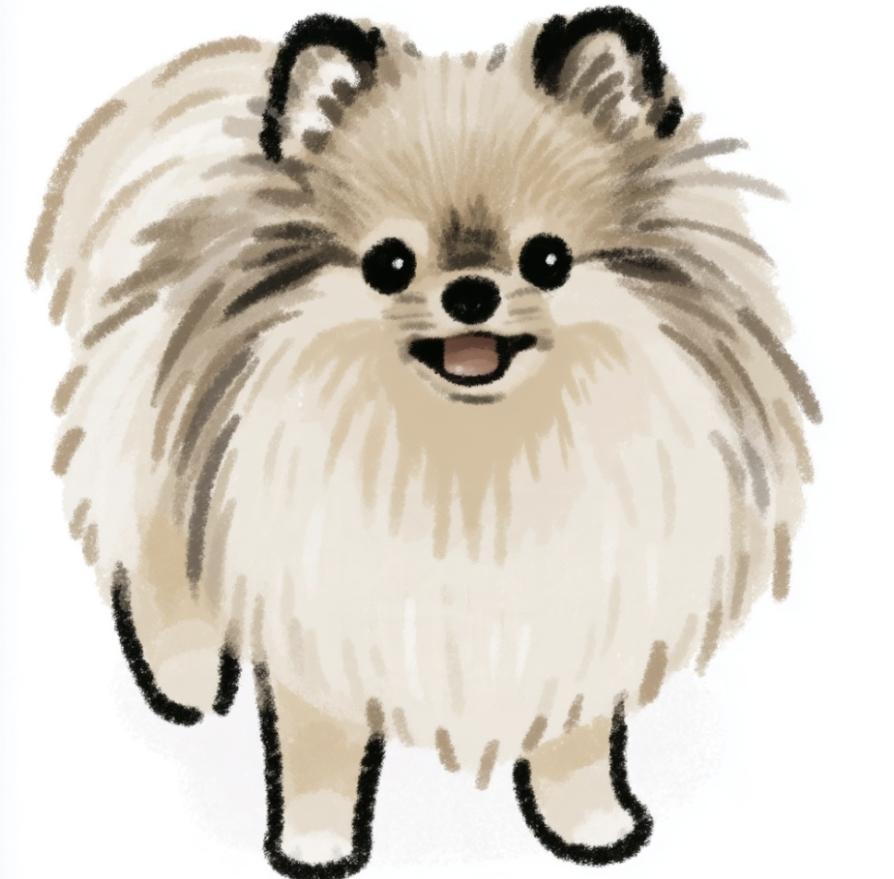

# 채채 인스타툰 마스터 에셋

사용자가 선택한 원본 10개입니다. 원본의 색상·해상도·배경·글자를 변경하지 않고 보관합니다.

M00은 기본 외형·화풍 마스터이며, A07·A08·A09는 사용자가 지정한 최신 보정 자세 마스터입니다.

| ID | 에셋 | 이미지 | 원본 파일명 |
|---|---|---|---|
| M00 | 기본 마스터 | [보기](assets/M00.png) | chaechae_master(1).png |
| A01 | 정색 | [보기](assets/A01.png) | 정색 채채.png |
| A02 | 서운함·시무룩 | [보기](assets/A02.png) | [Instatoon_Asset]_Chaechae_Expression_Aggrieved.png |
| A03 | 슬픈 표정 | [보기](assets/A03.png) | 슬픈 표정의 복슬복슬 포메라니안(2).png |
| A04 | 멍함·엎드림 | [보기](assets/A04.png) | 멍한 표정의 엎드린 채채 강아지.png |
| A05 | 냠냠 | [보기](assets/A05.png) | 껌 막대 씹는 포메라니안 얌얌(1).png |
| A06 | 쿨쿨·반정면 혀 빼꼼 | [보기](assets/A06.png) | 쿨쿨 잠든 포메라니안(1).png |
| A07 | 쿨쿨·옆으로 누움 | [보기](assets/A07.png) | 크림빛 동물의 부드러운 발과 다리(1).png |
| A08 | 옆모습·서기 | [보기](assets/A08.png) | 연한 크림빛 다리와 발(1).png |
| A09 | 옆모습·앉기 | [보기](assets/A09.png) | 흰 종이 위 크림색 동물(1).png |

## 기본 마스터

## 제작 기준

- [제작·검수 기준서 v0.3](docs/production-guide-v0.3.md)
- [원본 파일명·역할·SHA-256 목록](asset_manifest.json)
- [에이전트 작업 기록 양식](job_record_template.json)

이미 승인된 에셋은 재생성하지 않고 재사용합니다. 추가 수정은 별도 버전으로 저장합니다.
